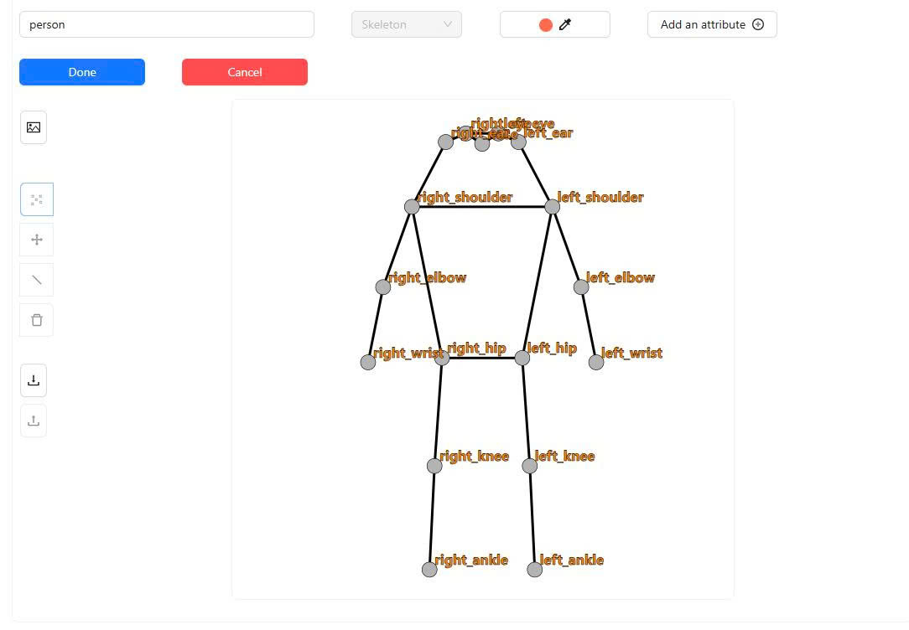
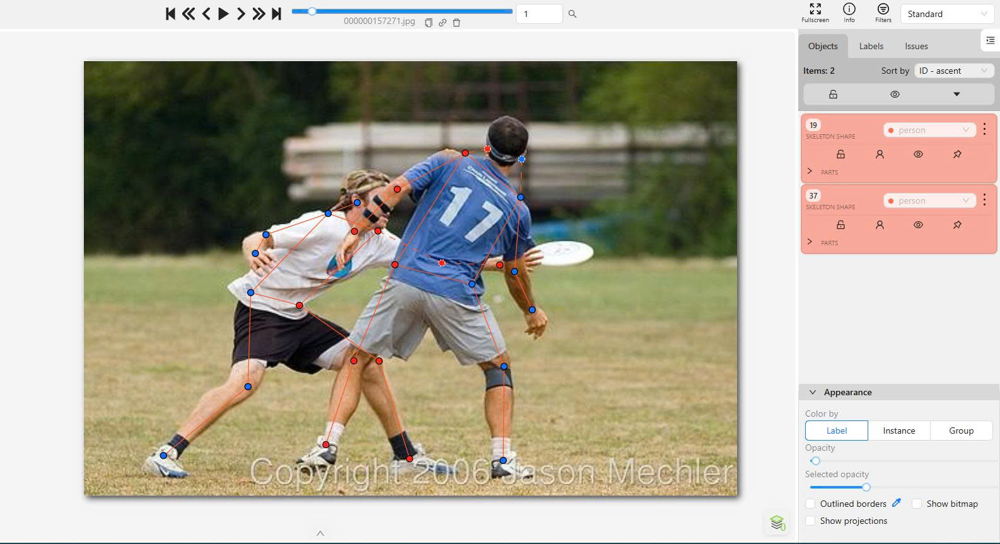
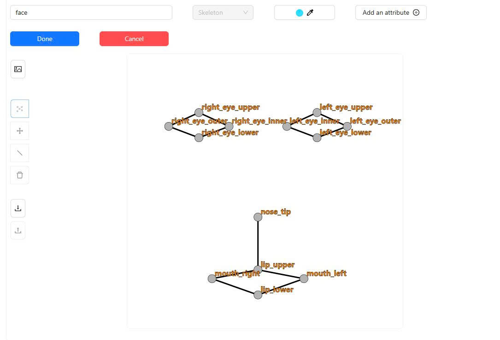
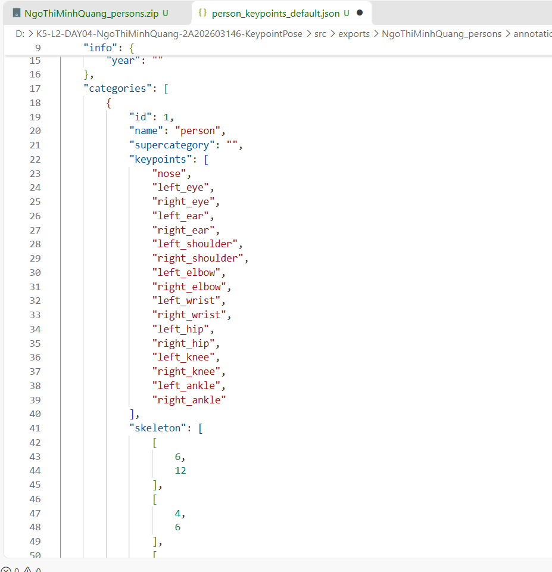

# Báo cáo cá nhân — NgoThiMinhQuang-2A202603146

**Bài thực hành K5 – Level 2 – Day 04: Keypoint Pose**

**Họ tên:** Ngô Thị Minh Quang  
**MSSV:** 2A202603146

## 0. Thông tin học viên

- Họ tên: Ngô Thị Minh Quang
- MSSV: 2A202603146
- Email: Chưa điền
- Link repository: https://github.com/NgoThiMinhQuang/K5-L2-DAY04-NgoThiMinhQuang-2A202603146-KeypointPose
- Phiên bản CVAT (Help → About): Chưa xác nhận
- Máy: Windows · RAM chưa ghi nhận · Chế độ CVAT: chưa xác định Full/Lite
- Bộ ảnh (`src/exports/assignment.json` do `lab.py setup` tạo): Có
- Giờ bắt đầu: Chưa ghi lại
- Giờ kết thúc: Chưa ghi lại

## 1. Kiểm tra label (CP0)

| Label | Kiểu | Số điểm | Tên điểm đúng bảng của lab? | Đúng thứ tự? | Số cạnh |
|---|---|---:|---|---|---:|
| `person` | Skeleton | 17 | Có | Có | 19 |
| `face` | Skeleton | 13 | Có | Có | 13 |

Mẫu `person` dựng theo người quay mặt về camera (các điểm `left_*` nằm bên phải khung mẫu): Có.

Cách đổi cờ `occluded` / `outside` cho một điểm trên CVAT:

Rê chuột vào đúng keypoint cần thay đổi, nhấn `Q` để chuyển sang `occluded` (v = 1), nhấn `O` để chuyển sang `outside` (v = 0), hoặc nhấn chuột phải để chọn trạng thái tương ứng. Cần chú ý chỉ thay đổi trạng thái của điểm đang chọn, không sử dụng `Hidden` để thay cho `occluded`.

## 2. Số lượng đã gán và thời gian (CP1, CP2)

| Nhóm ảnh | Số ảnh | Số skeleton đã gán | Số người dưới 60 px (không gán) | Số poster / gương / màn hình bỏ qua | Thời gian (phút) |
|---|---:|---:|---:|---:|---:|
| `easy` | 5 | Đối chiếu assignment.json | Chưa thống kê riêng | Chưa thống kê riêng | Chưa ghi lại |
| `occluded` | 3 | Đối chiếu assignment.json | Chưa thống kê riêng | Chưa thống kê riêng | Chưa ghi lại |
| `back` | 2 | Đối chiếu assignment.json | Chưa thống kê riêng | Chưa thống kê riêng | Chưa ghi lại |
| `small` | 1 | Đối chiếu assignment.json | Chưa thống kê riêng | Chưa thống kê riêng | Chưa ghi lại |
| `crowd` | 1 | Đối chiếu assignment.json | Chưa thống kê riêng | Chưa thống kê riêng | Chưa ghi lại |
| `faces` | 8 | 8 | — | — | Chưa ghi lại |

**Tổng kết số lượng:**

- Person: 12 ảnh, 20 skeleton.
- Face: 8 ảnh, 8 skeleton.
- Tổng cộng: 20 skeleton người và 8 skeleton khuôn mặt.

Số skeleton Person theo từng ảnh:

| Ảnh | Skeleton |
|---|---:|
| `000000090646.jpg` | 1 |
| `000000157271.jpg` | 2 |
| `000000196283.jpg` | 1 |
| `000000314154.jpg` | 1 |
| `000000324953.jpg` | 2 |
| `000000381889.jpg` | 3 |
| `000000390585.jpg` | 1 |
| `000000451084.jpg` | 1 |
| `000000515309.jpg` | 2 |
| `000000518966.jpg` | 2 |
| `000000564304.jpg` | 1 |
| `000000572411.jpg` | 3 |
| **Tổng** | **20** |

- Số ảnh người đã xong ở mốc phút 105: Chưa ghi lại.
- Thời gian thực tế (phút): CP1 chưa ghi lại · CP2 chưa ghi lại · CP3 chưa ghi lại.
- Ảnh tốn thời gian nhất là `000000381889.jpg`, vì trong ảnh có ba người đứng gần nhau, nhiều bộ phận chồng lấn. Việc xác định hướng trái/phải và vị trí hai khớp hông cần quan sát kỹ. Ngoài ra, ảnh `000000572411.jpg` cũng mất thời gian rà soát do người trong toa tàu có kích thước nhỏ và nhiều bộ phận bị che khuất.

**Ghi chú về đối tượng không gán:**

Ở ảnh `000000090646.jpg`, mình chỉ gán skeleton cho người thật trong ảnh, không gán cho mannequin đứng bên cạnh. Với những người có kích thước dưới 60 px hoặc không đủ điều kiện xác định keypoint, mình không tạo skeleton. Số lượng cụ thể cần được đối chiếu lại từ ảnh gốc và `assignment.json` trước khi chốt bảng thống kê.

## 3. Bảng ca khó (CP1, CP2)

Trong quá trình gán nhãn, những trường hợp khó nhất chủ yếu liên quan đến người bị che khuất, người ở xa, người bị cắt khỏi khung hình và việc xác định đúng trái/phải theo hướng cơ thể.

| Ảnh | Người / mặt | Điểm | Cờ đã chọn | Phân vân giữa | Lý do chọn |
|---|---|---|---|---|---|
| `000000381889.jpg` | Person 1–3 | `left_hip`, `right_hip` | Theo độ hiển thị của từng điểm | Trái/phải | Ba người đứng gần nhau, các bộ phận cơ thể chồng lấn. Cần xác định đúng bên trái/phải theo chính người trong ảnh. |
| `000000572411.jpg` | Person 1–3 | Các khớp thân và chân | Theo từng điểm `v=0/1/2` | `v=1` và `v=0` | Người ngồi trong toa tàu bị che khuất một phần. Chỉ dùng `v=1` khi có thể ước lượng vị trí khớp tương đối chắc chắn; nếu không đủ căn cứ thì dùng `v=0`. |
| `000000518966.jpg` | Person 2 | Các điểm ở người sát mép phải | Theo từng điểm `v=0/1/2` | `v=1` và `v=0` | Một người bị cắt bởi mép ảnh. Cần phân biệt khớp bị che nhưng còn ước lượng được với khớp nằm ngoài khung hình, không kéo điểm về sát mép ảnh. |
| `face_168953.jpg` | Face 1 | Các điểm mắt và mí mắt | `v=2` tại điểm nhìn thấy | `v=1` và `v=2` | Ảnh hơi mờ và có kính, cần phóng to để xác định đường viền mí mắt và khóe mắt. |
| `face_296767.jpg` | Face 1 | Các điểm mắt | Cần đối chiếu lại file CVAT | `v=1` và `v=0` | Kính râm tối che khuất mắt. Cần căn cứ vào gọng kính để quyết định `occluded` nếu có thể ước lượng chắc chắn. |

## 4. Bảng tự review (CP3)

Sau khi hoàn thành gán nhãn, mình kiểm tra lại các skeleton theo hướng từ ảnh cuối về ảnh đầu. Mình tập trung vào các lỗi trái/phải, vị trí keypoint, những điểm bị che và các trường hợp người bị cắt khỏi khung hình.

| Ảnh | Người / mặt | Điểm | Mã lỗi | Ghi chú | Đã sửa? |
|---|---|---|---|---|---|
| `000000572411.jpg` | Person 1–3 | Các keypoint trên người | `position` | Lần kiểm tra trước có cảnh báo các điểm chỉ trải cao 46 px. Mình đã rà soát và chỉnh sửa lại; lần kiểm tra cuối không còn cảnh báo. | Có |
| `000000381889.jpg` | Person 1–3 | `left_hip`, `right_hip` | `lr_swap` | Phát hiện hai điểm hông bị đảo trái/phải. Mình đã đổi lại đúng vị trí và kiểm tra sau khi sửa. | Có |
| `000000518966.jpg` | Person 1–2 | Các điểm gần mép ảnh | `ok` | Đã rà soát lại hai người trong ảnh, chú ý người bị cắt một phần ở mép phải và các điểm không nằm trong khung hình. | Có |
| `000000090646.jpg` | Person 1 | Toàn bộ skeleton | `ok` | Chỉ gán người thật trong ảnh, không tạo skeleton cho mannequin. | Không cần sửa |
| `000000324953.jpg` | Person 1–2 | Vai, tay, hông và chân | `ok` | Kiểm tra lại hai người trong bếp, đặc biệt là hướng cơ thể và các khớp bị che. | Không cần sửa |
| `face_137371.jpg` | Face 1 | Các điểm mắt và miệng | `ok` | Kiểm tra lại các điểm mắt trong trường hợp nhắm mắt và vị trí các điểm môi. | Không cần sửa |
| `face_168953.jpg` | Face 1 | Các điểm mắt và khóe mắt | `ok` | Ảnh mờ, có kính; đã rà soát vị trí các điểm theo đường viền nhìn thấy. | Không cần sửa |
| `face_469647.jpg` | Face 1 | `nose_tip` | `ok` | Đã kiểm tra lại vị trí chóp mũi và xác nhận điểm được đặt đúng. | Không cần sửa |

**Lưu ý:** Bảng trên ghi nhận 8 trường hợp đã review. Riêng `face_296767.jpg` cần đối chiếu thêm trạng thái của các điểm mắt sau kính râm trước khi chốt toàn bộ self-review.

Tổng hợp số lỗi theo mã (các lỗi đã xác nhận):

| `lr_swap` | `vis_flag` | `position` | `missing` | `extra` | `ok` |
|---:|---:|---:|---:|---:|---:|
| 1 | 0 | 1 | 0 | 0 | 6 |

Điểm còn phân vân giữa `v = 1` và `v = 0`:

- Với người bị che khuất bởi vật thể hoặc người khác, nếu có thể ước lượng tương đối chính xác vị trí khớp dựa vào các bộ phận lân cận thì sử dụng `v = 1`.
- Với khớp nằm ngoài khung hình hoặc bị che hoàn toàn và không thể xác định đáng tin cậy thì sử dụng `v = 0`.
- Với ảnh khuôn mặt đeo kính râm tối, cần kiểm tra khả năng ước lượng vị trí mắt dựa vào gọng kính trước khi quyết định cờ.

## 5. Kiểm file xuất và kết quả tự kiểm (CP4)

### Tự kiểm cấu trúc file JSON

| File | Người / mặt kiểm (ảnh, thứ tự) | Số phần tử `keypoints` | Điểm `outside` ra `v = 0`, `occluded` ra `v = 1`? | `num_keypoints` khớp? |
|---|---|---:|---|---|
| `NgoThiMinhQuang_persons.zip` | Person trong `000000381889.jpg` | 51 | Theo quy tắc COCO | Script xác nhận |
| `NgoThiMinhQuang_persons.zip` | Person trong `000000572411.jpg` | 51 | Theo quy tắc COCO | Script xác nhận |
| `NgoThiMinhQuang_faces.zip` | Face trong `face_469647.jpg` | 39 | Theo quy tắc COCO | Script xác nhận |

Sau khi xuất, CVAT ghi:

- `occluded` thành `v = 1`.
- `outside` thành `v = 0`.
- Tọa độ của điểm `outside` trong file vẫn giữ tọa độ cũ, không tự chuyển về `0, 0`. Đây là cách CVAT 2.x xuất dữ liệu, không phải lỗi cấu trúc. Các điểm `v = 0` không được tính vào số keypoint hợp lệ khi huấn luyện và chấm.

Hai job chính đã chuyển sang completed trên CVAT: Có.

### Kết quả kiểm tra bộ dữ liệu chính

**File Person: `NgoThiMinhQuang_persons.zip`**

- Số ảnh: 12.
- Số skeleton `person`: 20.
- Mỗi annotation có 51 số.
- Cờ visibility: `v=2`: 221 (65%); `v=1`: 23 (7%); `v=0`: 96 (28%).
- `num_keypoints` trung bình: 12.2.

**File Face: `NgoThiMinhQuang_faces.zip`**

- Số ảnh: 8.
- Số skeleton `face`: 8.
- Mỗi annotation có 39 số.
- Cờ visibility: `v=2`: 94 (90%); `v=1`: 2 (2%); `v=0`: 8 (8%).
- `num_keypoints` trung bình: 12.0.

Kết quả tự kiểm cuối cùng:

```text
== Xuất COCO Keypoints 1.0
[OK] src\exports\NgoThiMinhQuang_persons.zip
[OK] src\exports\NgoThiMinhQuang_faces.zip

Số ảnh person: 12
Số skeleton person: 20
Mỗi annotation: 51 số

Số ảnh face: 8
Số skeleton face: 8
Mỗi annotation: 39 số

Số [LỖI]: 0
Số [CẢNH BÁO]: 0

Kết quả: ĐẠT
```

### Kết quả kiểm tra Bonus

Các file bonus cũng được xuất theo định dạng COCO Keypoints 1.0 và kiểm tra riêng bằng script.

- Bonus Person: 3 ảnh, 7 skeleton.
- Bonus Face: 5 ảnh, 5 skeleton.
- Số lỗi: 0.
- Số cảnh báo: 0.
- Kết quả: ĐẠT.

Các cảnh báo ở lần kiểm tra trước đã được rà soát và xử lý. Không còn cảnh báo trong lần kiểm tra cuối cùng.

## 6. Ảnh chụp màn hình

1. Label `person` trong label constructor (đủ 17 điểm có tên):

   

2. Một người quay lưng đã gán, cờ đã đặt:

   

3. Một khuôn mặt đã gán 13 điểm, phóng to vùng mắt:

   

4. Một đoạn JSON xuất của một người:

   

Nguồn ảnh: COCO 2017 / bộ ảnh khuôn mặt được cung cấp trong lab.

## 7. Tự đánh giá

**1. Lỗi bạn mắc nhiều nhất hôm nay, và cách bạn sẽ tránh ở dự án thật:**

Lỗi mình cần chú ý nhất là xác định trái/phải của người trong ảnh, đặc biệt khi người quay lưng hoặc có nhiều người đứng gần nhau. Ở ảnh `000000381889.jpg`, mình đã phát hiện hai điểm hông bị đảo trái/phải khi tự review và đã sửa lại.

Nếu làm dự án thực tế, mình sẽ xác định hướng cơ thể trước khi đặt keypoint, sau đó kiểm tra lại tên từng điểm và đường nối giữa các khớp. Mình cũng sẽ phóng to ảnh khi đặt các điểm nhỏ như mắt, mũi và các khớp bị che.

**2. Một quy tắc bạn đề xuất thêm vào guideline (kèm ảnh ví dụ nếu có):**

Mình đề xuất guideline nên có thêm ví dụ cụ thể về trường hợp người bị cắt một phần ở mép ảnh và người có kích thước nhỏ nhưng vẫn nhìn thấy một số bộ phận cơ thể.

Nên phân biệt rõ người thực sự cao dưới 60 px với người có chiều cao lớn hơn nhưng bị che hoặc cắt khỏi khung hình. Hai trường hợp này không nên xử lý giống nhau vì có thể dẫn đến việc bỏ sót người đủ điều kiện gán nhãn.

**3. Nhãn của bạn đi vào model ở đâu? Chọn một lỗi bạn đã sửa và nói nó sẽ làm model học sai thế nào (heatmap, trọng số trong loss, hay bước lật ảnh):**

Mình chọn lỗi đảo `left_hip` và `right_hip` ở ảnh `000000381889.jpg`.

Nếu không sửa lỗi này, model sẽ học sai vị trí của hai khớp hông vì mỗi keypoint được gắn với một tên và một kênh heatmap riêng. Khi huấn luyện, model có thể học nhầm hông trái thành hông phải. Lỗi này cũng ảnh hưởng đến bước lật ảnh ngang, vì các cặp trái/phải cần được hoán đổi đúng khi tăng cường dữ liệu.

Việc tự review và sửa lỗi trước khi xuất file giúp hạn chế đưa những nhãn sai vào quá trình huấn luyện.

## 8. Khó khăn và lỗi kỹ thuật

Trong quá trình thực hiện, mình gặp một số khó khăn:

- Người trong ảnh đứng gần nhau hoặc bị che khuất khiến việc xác định từng bộ phận cơ thể gặp khó khăn.
- Một số người có tư thế quay lưng, nghiêng hoặc co người nên việc xác định trái/phải cần quan sát kỹ.
- Ở ảnh `000000572411.jpg`, người trong toa tàu có kích thước nhỏ, các điểm tập trung trong một vùng hẹp. Mình phải kiểm tra lại để tránh nhầm người nhỏ với người bị che khuất.
- Ở ảnh `000000518966.jpg`, có người bị cắt một phần ở mép ảnh, cần phân biệt các điểm nằm ngoài khung hình với các điểm bị che.
- Với ảnh khuôn mặt có kính, ảnh mờ hoặc tóc che một phần, việc xác định chính xác khóe mắt và đường viền mí cần phóng to để quan sát.
- Khi thao tác trên CVAT, cần chú ý rê chuột đúng vào keypoint trước khi đổi cờ visibility để tránh thay đổi nhầm điểm khác.

Về xuất dữ liệu, mình sử dụng COCO Keypoints 1.0 và chạy script tự kiểm sau khi xuất. Một điểm cần lưu ý là tọa độ của keypoint có `v = 0` vẫn có thể được CVAT giữ nguyên trong file JSON. Mình đã đối chiếu với ghi chú của lab và xác định đây không phải lỗi cấu trúc file.

Sau khi chỉnh sửa và xuất lại, cả hai file chính và hai file bonus đều vượt qua bước kiểm tra tự động.

## 9. Tài liệu tham khảo và công cụ AI đã dùng

**Tài liệu tham khảo:**

1. `README.md` – Lab Ngày 4: Gán Keypoint và Pose.
2. `RULES.md` – Quy định và yêu cầu thực hiện bài.
3. `docs/GUIDELINE.md` – Quy ước 17 điểm Person, 13 điểm Face và visibility.
4. `docs/CVAT_CHEATSHEET.md` – Hướng dẫn thao tác và đổi cờ trên CVAT.
5. `CHECKPOINTS.md` – Các checkpoint CP0–CP4.
6. `RUBRIC.md` – Tiêu chí đánh giá bài thực hành.
7. `SUBMISSION.md` – Quy định cấu trúc và nội dung bài nộp.
8. `src/check_submission.py` – Công cụ kiểm tra dữ liệu COCO Keypoints 1.0.

**Công cụ sử dụng:**

- CVAT: tạo và chỉnh sửa các skeleton Person, Face.
- Python: chạy công cụ xuất dữ liệu và kiểm tra file.

## Bonus (nếu làm)

### B1 — 3 ảnh người khó thêm

| Ảnh | Số skeleton | Số người dưới 60 px | Ca khó nhất |
|---|---:|---:|---|
| `000000005294.jpg` | 1 | Chưa thống kê riêng | Đã xóa 2 skeleton không đủ điều kiện sau khi kiểm tra lại. |
| `000000373426.jpg` | 3 | Chưa thống kê riêng | Ảnh có ba người, cần kiểm tra riêng từng skeleton. |
| `000000565600.jpg` | 3 | Chưa thống kê riêng | Cần kiểm tra vị trí và visibility của từng người. |

Kết quả `src/check_submission.py` cho `NgoThiMinhQuang_bonus_persons.zip`:

```text
File: NgoThiMinhQuang_bonus_persons.zip
Số ảnh: 3
Số skeleton person: 7
Mỗi annotation: 51 số

Skeleton theo ảnh:
000000005294 = 1
000000373426 = 3
000000565600 = 3

Cờ v:
v=2: 79 (66%)
v=1: 3 (3%)
v=0: 37 (31%)

num_keypoints trung bình: 11.7

Số [LỖI]: 0
Số [CẢNH BÁO]: 0

Kết quả: ĐẠT
```

### B2 — 5 ảnh khuôn mặt đen trắng / hồng ngoại

Ảnh không màu khó hơn ảnh màu vì không có thông tin màu sắc để phân biệt các vùng trên khuôn mặt. Khi xác định vị trí mí mắt, khóe mắt và môi, mình phải dựa nhiều hơn vào đường nét, độ sáng tối và hình dạng của từng bộ phận.

Đối với kính râm trên ảnh hồng ngoại, vẫn cần căn cứ vào mức độ che khuất thực tế. Nếu mắt bị che nhưng vị trí có thể ước lượng chắc chắn dựa vào gọng kính thì sử dụng `v = 1`. Nếu không thể xác định đáng tin cậy thì sử dụng `v = 0`.

Kết quả `src/check_submission.py` cho `NgoThiMinhQuang_bonus_faces.zip`:

```text
File: NgoThiMinhQuang_bonus_faces.zip
Số ảnh: 5
Số skeleton face: 5
Mỗi annotation: 39 số

Skeleton theo ảnh:
face_102517 = 1
face_296417 = 1
face_317330 = 1
face_344941 = 1
face_507166 = 1

Cờ v:
v=2: 65 (100%)
v=1: 0 (0%)
v=0: 0 (0%)

num_keypoints trung bình: 13.0

Số [LỖI]: 0
Số [CẢNH BÁO]: 0

Kết quả: ĐẠT
```

### B3 — Model so với nhãn của tôi (không tính điểm)

Không thực hiện.
